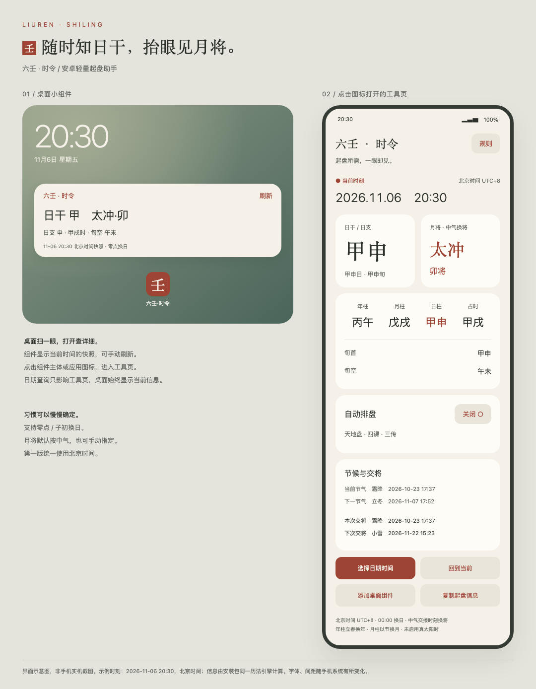
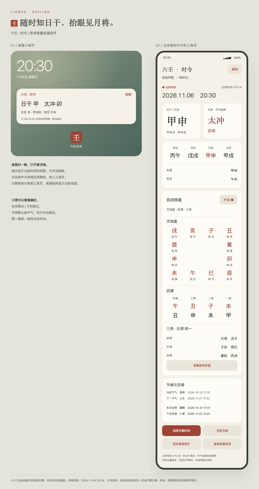

# 六壬 · 时令 0.2.0

安卓原生离线起盘信息助手，一个 APK 同时包含应用与桌面小组件。默认显示历法与起盘信息；用户可开启自动排盘，显示天地盘、四课与三传。桌面小组件保持简洁。

[下载最新版 APK](https://github.com/xushuran06-lab/liuren-shiling/releases/latest) · [查看排盘规则](docs/chart-rules.md)



## 安装与试用

1. 将 `releases/Liuren-Shiling-0.2.0.apk` 传到安卓手机，打开安装；系统如询问，请仅为打开该文件的应用允许本次安装来源。
2. 打开「六壬·时令」，查看当前日干、日支、月将、年/月/日/时干支、旬首、旬空与节气交接信息。
3. 点击「添加桌面组件」，按手机桌面的提示添加；也可长按桌面空白处 → 小组件 → 六壬·时令。
4. 点击组件主体可打开应用；点击组件「刷新」可重新计算当前信息。
5. 在应用点「选择日期时间」查询其他时刻；点「回到当前」恢复实时模式。
6. 首页「自动排盘」开关默认关闭。开启后显示天地盘、四课、三传、遁干六亲；可查看取传依据，复制时一并复制盘面。关闭后只显示原有信息，桌面组件不受影响。

小米 / HyperOS：桌面双指捏合 → 添加小部件 → 全部应用（或支持小部件应用旁的全部）→ 安卓小部件 → 六壬·时令。应用内直接添加若无弹窗，可采用此入口。用户已在小米17上确认原有组件可添加和显示；0.2.0的新排盘页面尚未实机验收。

支持 Android 8.0 / API 26 及以上。APK 约 161 KiB，无网络权限，无账号，不需额外运行时下载。应用以本地开发密钥签名；后续本地测试版应保留原密钥以便覆盖安装。



## 默认规则和设置

- 所有输入与显示固定为北京时间 UTC+8，不随手机系统时区改变。
- 默认 **00:00 换日**，可切换 **23:00 子初换日**。
- 日干、日支、旬首、旬空与时干随同一换日规则计算。零点换日时，23点采用当日日干起子时；子初换日时采用次日日干起子时。本版不额外提供“日干不变而时干先换”的晚子时规则。
- 年柱按立春交接时刻换年；月柱按十二节交接时刻换月。
- 月将默认按十二中气的交接时刻切换，支持手动指定十二月将。手动选择后，应用和组件均显式标注。
- 雨水登明亥、春分河魁戌、谷雨从魁酉、小满传送申、夏至小吉未、大暑胜光午、处暑太乙巳、秋分天罡辰、霜降太冲卯、小雪功曹寅、冬至大吉丑、大寒神后子。
- 支持查询 1901—2099 年；本版未提供真太阳时、定位与经度修正。

日期选择只影响应用；小组件始终使用当前北京时间及已保存的换日、月将规则。手动日期在旋转屏幕时保留，重新冷启动回到当前时刻；规则持久保存在应用私有空间。

## 小组件更新

组件显示带更新时间的**快照**。注册 30 分钟周期更新，应用打开、修改规则、点击刷新时也会更新。安卓后台调度及厂商省电策略可能延后更新，不保证在交将或时辰切换的秒级边界自动刷新。起盘前、特别是临近边界时请点击「刷新」。应用前台按分钟重新计算。

系统更新限制参考：[Android 官方小组件更新文档](https://developer.android.com/develop/ui/views/appwidgets/advanced)。

## 预览与验证

- `preview/preview.png`：桌面组件与工具页的界面示意，**非安卓实机截图**。
- `preview/index.html`：同一示意图的可打开页面；按钮为静态示意，实际功能位于 APK。
- 已通过 Java 编译、AAPT2 清单/资源编译、D8、ZIP 完整性、16KB zipalign、APK v2/v3 签名验证；清单已识别应用入口及 app-widget，无 uses-permission。
- 历法测试 **170 项断言通过**：甲子日锚点、60日干支/旬空推进、零点与子初换日、时辰边界、12次中气换将的前一秒与交接秒、立春换年换月、闰日、支持范围端点和手动月将。
- 使用香港天文台《2026年历》公布的小雪 11月22日15:23（UTC+8），独立验证交将前后结果。算法节气时刻与天文台出版物四舍五入的分钟显示可能存在一分钟表观差异；界面按算法时间截取至分钟。
- 新增排盘检查：37,176项断言，覆盖720基本课与8640组日干支/月将/占时组合的结构及轮转不变量，包含24个独立指定课例（含10个课经原文例）。此为边界与一致性检查，不等于720课逐课与古籍校准。详见[规则与验证范围](docs/chart-rules.md)。
- 用户已在小米17上确认此前版本的应用启动及桌面组件显示；0.2.0的开关、排盘页面、剪贴板与日期选择器尚未进行真机或模拟器验收。

独立天文参考：[香港天文台2026年11月月历](https://my.weather.gov.hk/en/gts/astron2026/files/2026cal11.pdf)。

## 源码与构建

核心路径：

- `android/src/dev/liuren/pocket/ChartEngine.java`：可选的九宗门排盘引擎，完全离线。
- `android/src/dev/liuren/pocket/CalendarEngine.java`：与 Android 界面分离的历法与规则计算。
- `android/src/dev/liuren/pocket/MainActivity.java`：原生工具页、日期/时间选择、规则设置、复制与添加小组件。
- `android/src/dev/liuren/pocket/LiurenWidget.java`：RemoteViews 桌面小组件，复用同一引擎与规则。
- `android/build.py`：无 Gradle 构建脚本；不需联网。
- `tests/EngineTest.java`：边界与参考值验证。

克隆后在仓库目录执行（JDK 21）：

```sh
python3 tests/run.py --java /path/to/jdk
python3 android/build.py --java /path/to/jdk --tools /path/to/build-tools/36.0.0 --platform /path/to/platforms/android-36
```

其他环境需安装 JDK 21、Android SDK Build Tools 36.0.0 和 Android 36 Platform，再运行：

```sh
python3 android/build.py --java /path/to/jdk --tools /path/to/build-tools/36.0.0 --platform /path/to/platforms/android-36
```

构建产生的 `android/build/` 和 `android/.signing/` 已忽略；签名密钥不得进入源码分发压缩包。重建默认复用本地开发密钥。

## 开源依赖

历法采用 [6tail/lunar-java](https://github.com/6tail/lunar-java)，MIT 许可。固定源码提交：`9e1245dfb13bdca9b43100534e2796f36819ca46`。完整许可证保存在 `vendor/lunar-java/LICENSE`，同时内置于 APK 的 assets 并可在「规则 → 关于与开源许可」查看。

## 0.1.1：添加桌面组件的反馈修正

- 检查桌面是否支持及是否接受添加请求，捕获系统启动窗口异常。
- 提交后立即显示提示，通过系统成功回调确认添加；未确认时提供手动添加说明与返回桌面按钮。
- 返回应用获得焦点后再次检查待处理的请求；未收到回调不代表一定失败，提示采用“尚未确认”措辞。
- 包名及开发签名保持一致，可直接覆盖0.1.0安装，不需卸载；历法计算未改动。
- 已通过编译、资源检查、APK签名及对齐校验；尚未完成出现问题的手机桌面的实机验证。

## 0.2.0：可选自动排盘

首页新增自动排盘开关，默认关闭并本地保存。开启后展示天地盘、四课、三传及遁干六亲，并可查看发用依据；沿用所选时间与历法规则。小组件布局、信息和刷新机制未改动。

项目自身代码采用[MIT许可证](LICENSE)，历法库保留6tail原始MIT许可证。欢迎提交问题与带取法依据的课例。
